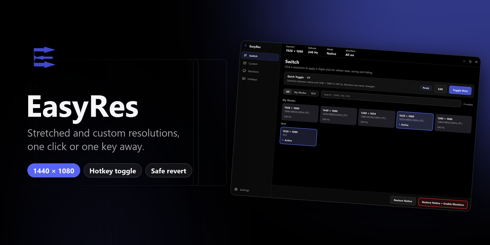
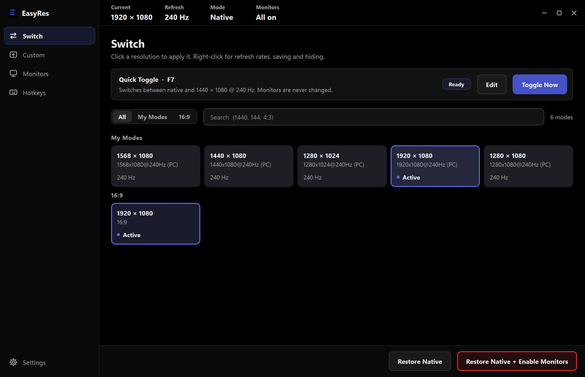
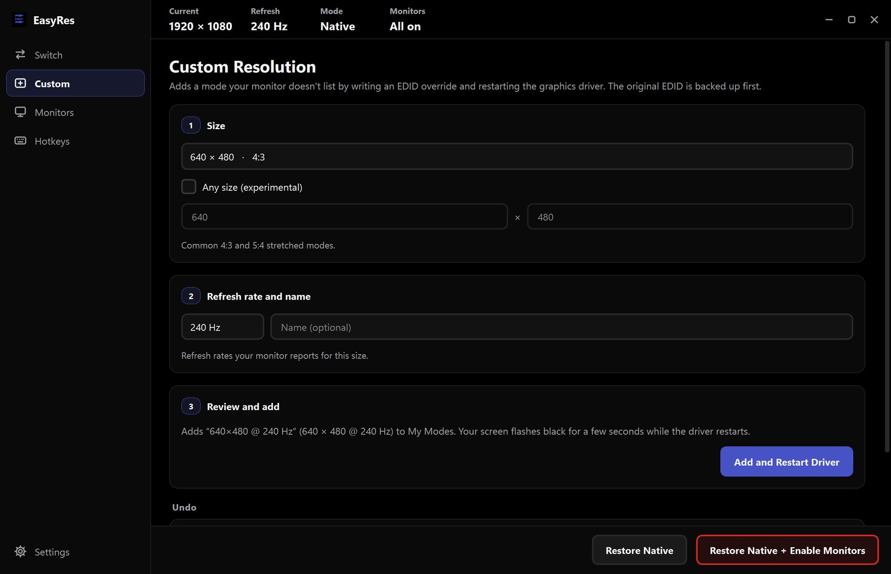
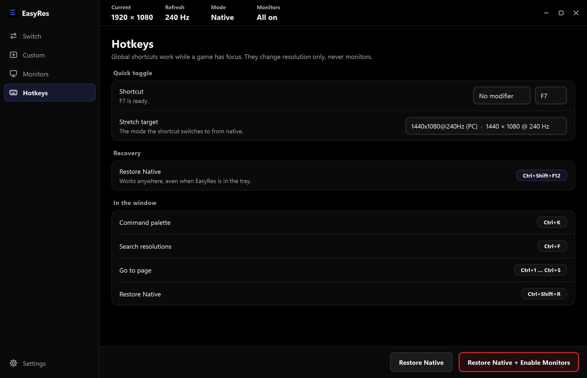
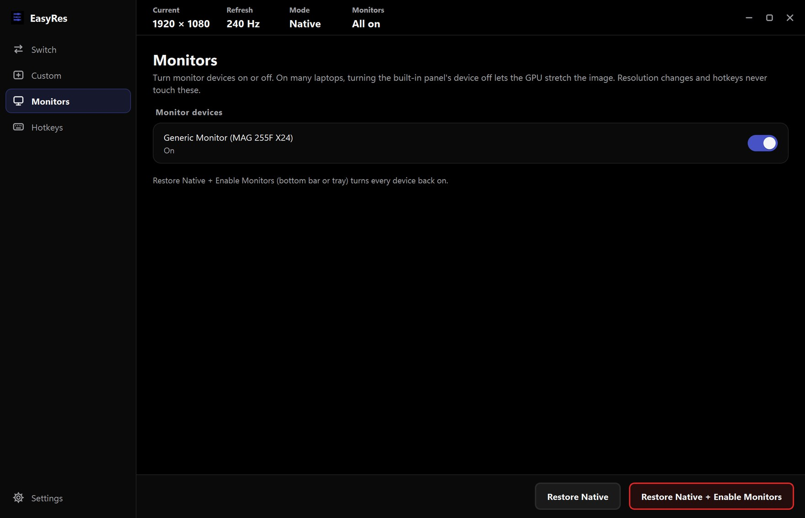
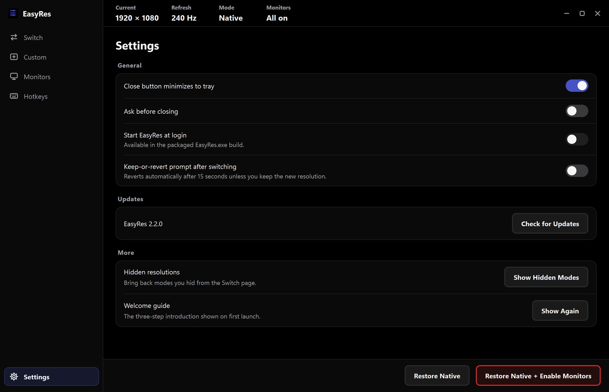

<div align="center">



<br />

<a href="https://github.com/mohibk0004-del/easyres/releases/latest"></a>


<h3>Stretched res without the GPU control panel.</h3>

<p>EasyRes switches Windows between your native resolution and competitive modes like <b>1440 × 1080</b> or <b>1280 × 960</b> in one click,<br/>or one key in-game. It adds modes your monitor doesn't list, and always gives you a way back.</p>

<a href="https://github.com/mohibk0004-del/easyres/releases/latest"><b>Download EasyRes.exe</b></a>
&nbsp;·&nbsp;
<a href="#-features">Features</a>
&nbsp;·&nbsp;
<a href="#-safety">Safety</a>
&nbsp;·&nbsp;
<a href="#-build-from-source">Build</a>

</div>

<br />

## ⚡ Get started

1. **Download** `EasyRes.exe` from the [latest release](https://github.com/mohibk0004-del/easyres/releases/latest). No installer: it's a single portable file.
2. **Run it** and approve the admin prompt.
3. **Click a resolution**, or pick a stretch target on **Hotkeys** and press **F6** in-game to flip between native and stretched.

> [!TIP]
> Something went wrong? Press **Ctrl + Shift + F12** from anywhere, even with EasyRes in the tray, to go straight back to native.

<br />

## ✨ Features

<div align="center">

<sub><b>Switch</b>: every mode your display supports, grouped by aspect ratio, with your saved modes first.</sub>
</div>

<br />

<table>
<tr>
<td width="50%" valign="top">

### 🖥️ One-click switching
Resolution tiles grouped by aspect ratio, a search that understands `1440`, `144` or `4:3`, and right-click for refresh rates, saving and hiding. The status strip always shows the current resolution, refresh rate, mode and monitor state.

### ⌨️ Quick toggle hotkey
A global shortcut flips between native and your stretch target while a game has focus. It only ever changes resolution, never monitors.

### ↩️ Keep or revert
Every switch made in the window starts a **15-second keep-or-revert countdown**. Don't confirm, and EasyRes puts the old mode back on its own.

</td>
<td width="50%" valign="top">

### ➕ Custom resolutions
Add a mode your monitor doesn't list. EasyRes writes an EDID override, backs up the original first, and restarts the graphics driver. **Restore Original EDID** undoes it.

### 💡 Monitor control for True Stretch
Turn monitor devices on or off. On many gaming laptops, switching off the built-in panel's device is what lets the GPU stretch the image. Kept fully separate from resolution changes.

### 🧭 Stays out of the way
Lives in the system tray with a quick-switch menu, starts at login without a UAC prompt, a command palette on **Ctrl + K**, and **in-app updates** that are verified before they install.

</td>
</tr>
</table>

<br />

<table>
<tr>
<td width="50%"><p align="center"><sub><b>Custom</b>: three steps, with the original EDID backed up first.</sub></p></td>
<td width="50%"><p align="center"><sub><b>Hotkeys</b>: quick toggle, stretch target and recovery shortcuts.</sub></p></td>
</tr>
<tr>
<td width="50%"><p align="center"><sub><b>Monitors</b>: turn monitor devices on or off for True Stretch.</sub></p></td>
<td width="50%"><p align="center"><sub><b>Settings</b>: tray behaviour, start at login, revert prompt and updates.</sub></p></td>
</tr>
</table>

<br />

## ⌨️ Shortcuts

| Shortcut | Where | Does |
|---|---|---|
| **F6** *(configurable)* | Anywhere | Toggle native ↔ stretch target |
| **Ctrl + Shift + F12** | Anywhere | Restore native resolution |
| **Ctrl + K** | In the window | Command palette |
| **Ctrl + F** | In the window | Search resolutions |
| **Ctrl + 1 … 5** | In the window | Go to page |
| **Ctrl + Shift + R** | In the window | Restore native resolution |

<br />

## 🛡️ Safety

| | |
|---|---|
| **No game injection** | EasyRes uses documented Windows display APIs (`ChangeDisplaySettingsEx`, `DEVMODE`) and standard system tools. It never reads or writes game memory. Anti-cheat policies are set by each game publisher, so check your game's rules before use. |
| **Always a way back** | Keep-or-revert countdown after every switch, a global Restore Native hotkey, and **Restore Native + Enable Monitors** in the bottom bar and tray. |
| **Tested before applied** | Modes are validated with `CDS_TEST` before Windows commits them. |
| **Backed-up EDID** | Custom resolutions back up your monitor's original EDID first, and one button restores it. |
| **Verified updates** | Updates are only accepted when their size and GitHub SHA-256 digest match. Releases without a digest are refused, and a failed update rolls back. |

> [!WARNING]
> **Any size (experimental)** lets you enter timings your monitor may not support, which can cause an out-of-range black screen until it reverts. Prefer the standard stretched presets. On OLED panels, avoid stretch and monitor-toggle workflows.

<br />

## 🏗️ Build from source

**Requirements:** Windows 10/11 (64-bit), Python 3.10+, and administrator rights for monitor toggling, EDID overrides and driver restarts.

```bash
pip install -r requirements.txt
python main.py                          # run from source
.\build.bat                             # portable build -> dist/EasyRes.exe
python -m unittest discover -s tests    # tests
```

Optional: put `Inter-Regular.ttf`, `Inter-Medium.ttf`, `Inter-SemiBold.ttf` and `Inter-Bold.ttf` (SIL Open Font License) in `assets/fonts/` to bundle Inter. Otherwise EasyRes uses Segoe UI.

<details>
<summary><b>Architecture</b></summary>
<br />

| | |
|---|---|
| **UI** | PyQt6 sidebar + pages shell (`ui/app_window.py`, `ui/pages/`) driven by a widget-free `AppController` (`ui/controller.py`). Native Windows chrome via DWM (`ui/native_chrome.py`: real shadow, Windows 11 rounded corners, Snap Layouts), in-window sheets, one property-driven stylesheet (`theme/styles.py`), and background workers for every blocking system call. Set `EASYRES_QT_FRAME=1` for a Qt-only frame. |
| **Core** | `ctypes` bindings to `user32.dll` and `kernel32.dll`. |
| **Display parsing** | Reads valid EDID bounds via `EnumDisplaySettingsW` and builds clean `DEVMODE` blocks so drivers don't reject padded requests. |
| **Startup** | A Task Scheduler logon task with the highest run level, because Windows skips elevated apps listed under the Run key. |

</details>

<details>
<summary><b>Publishing a release</b></summary>
<br />

Bump `CURRENT_VERSION` in `updater.py` and push a tag like `v2.3.0`. The **Release** workflow builds `EasyRes.exe` on Windows, smoke-tests it and publishes it to GitHub Releases. Tags with a suffix (`v2.3.0-rc1`) become pre-releases, which the in-app updater ignores. The asset must be named exactly `EasyRes.exe`.

</details>

<br />

<div align="center">
<sub>Precise, fast, and out of your way. <a href="https://github.com/mohibk0004-del/easyres/issues">Report a problem</a> · <a href="https://github.com/mohibk0004-del/easyres/releases">Releases</a></sub>
</div>
